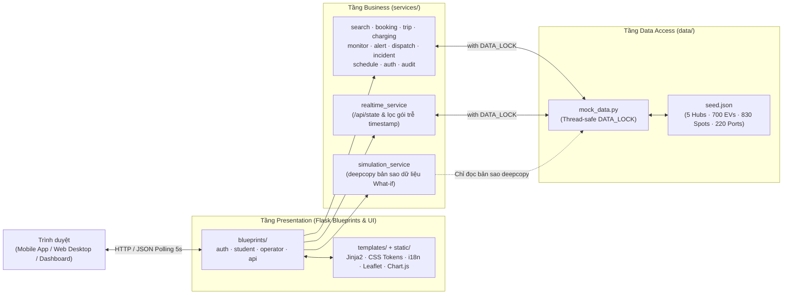

<div align="center">

# ⚡ Smart E-Mobility Hub (E-Hub)

**Nền tảng quản lý, đặt chỗ và điều phối phương tiện điện thông minh đa trạm**


-0EA5E9)


[🎥 Video Demo Sản Phẩm (Google Drive)](https://drive.google.com/file/d/1Nb6LbpEvITgVQEpR5PqJwCxiSEFxwJsL/view?usp=sharing) · [🚀 Chạy nhanh](#-cài-đặt--khởi-chạy-nhanh) · [🏗️ Kiến trúc](#️-kiến-trúc-hệ-thống) · [🧪 Kiểm thử & Demo kỹ thuật](#-kiểm-chứng-kỹ-thuật--automated-tests)

</div>

---

## 📖 Tổng quan dự án

**Smart E-Mobility Hub (E-Hub)** là hệ thống web điều phối phương tiện điện (xe đạp/xe máy điện, chỗ đỗ thông minh và trạm sạc nhanh) cho khu đô thị đại học quy mô **5 Hub, 700 phương tiện, 830 chỗ đỗ và 220 cổng sạc**.

Hệ thống được thiết kế theo mô hình **hai phân hệ tách biệt (Dual-Portal)**:
1. **Cổng Người dùng / Sinh viên (Rider Portal)**: Giao diện tự thích ứng (**Responsive Web Desktop** và **Mobile App 414px**) cho phép tìm Hub gần nhất trên bản đồ tương tác, đặt xe, đặt chỗ đỗ, nhận/trả xe và đăng ký trạm sạc.
2. **Trung tâm Vận hành (Operator Control Center)**: Dashboard chuyên biệt cho điều hành viên theo dõi toàn mạng lưới theo thời gian thực (polling 5 giây), nhận cảnh báo quá tải, xử lý sự cố, điều phối xe liên trạm, lập lịch sạc thông minh và mô phỏng dự báo **What-if** cô lập dữ liệu.

---

## ✨ Tính năng nổi bật

### 🛵 Phân hệ Người dùng (`UC1 – UC7`)
| Chức năng | Mô tả chi tiết |
|---|---|
| **Tìm kiếm & Điều hướng Hub** | Tích hợp bản đồ **Leaflet** hiển thị 5 Hub, bộ lọc theo bán kính/mức pin tối thiểu và vẽ tuyến đường đi bộ từ vị trí hiện tại tới trạm. |
| **Theo dõi tài nguyên trạm** | Xem chi tiết số xe khả dụng, chỗ đỗ còn trống, cổng sạc khả dụng và danh sách phương tiện kèm % pin theo thời gian thực. |
| **Đặt xe & Chỗ đỗ chống xung đột** | Cơ chế giữ xe có thời hạn (15 phút), kiểm tra khóa đồng bộ chống **race condition** khi nhiều người đặt trùng một xe; chặn đặt chỗ đỗ trong quá khứ hoặc khi Hub đầy. |
| **Nhận xe, Theo dõi chuyến & Trả xe** | Xác nhận nhận xe chuyển sang màn hình chuyến đi kèm bản đồ hành trình và mức pin; kiểm tra sức chứa trạm đích khi trả xe. |
| **Gợi ý & Đăng ký sạc thông minh** | Đề xuất trạm sạc khẩn cấp gần nhất khi pin yếu, chọn khung giờ sạc khả dụng và xác nhận giữ cổng sạc. |

### 🖥️ Phân hệ Điều hành & Vận hành (`UC8 – UC14`)
| Chức năng | Mô tả chi tiết |
|---|---|
| **Tổng quan mạng lưới thời gian thực** | KPI toàn mạng (tổng xe, chỗ trống, cổng sạc, sự cố), luồng cảnh báo/sự cố nổi bật, bộ lọc trạng thái Hub (`Hoạt động`/`Ngoại tuyến`, `An toàn`/`Nguy hiểm`/`Quá tải`) và nhật ký gói trễ (`PACKET_LOG`). |
| **Giám sát tài nguyên chi tiết** | Tra cứu và lọc trực tiếp từng phương tiện, chỗ đỗ, cổng sạc theo từng Hub với khả năng làm mới dữ liệu tức thì. |
| **Cảnh báo quá tải đa cấp** | Phân loại mức độ nghiêm trọng (`HIGH` / `MEDIUM` / `LOW`), hiển thị tỷ lệ sử dụng so với ngưỡng, nguyên nhân dự kiến và điều hướng nhanh sang Điều phối. |
| **Điều phối phương tiện liên trạm** | Chọn Hub nguồn/đích trực quan trên bản đồ Leaflet hoặc danh sách, điều phối nhiều xe cùng lúc, quản lý và hủy lệnh điều phối đang chờ. |
| **Tiếp nhận & Xử lý sự cố** | Tạm ngưng tài nguyên gặp lỗi để bảo trì, gán lý do nhanh (`Quá tải trạm`, `Hỏng cổng sạc`, `Lỗi pin / sụt áp`, `Hỏng phanh / lốp xe`, `Mất kết nối IoT`, `GPS lệch vị trí`) và cập nhật tiến độ xử lý. |
| **Lập lịch sạc tự động** | Tự động tạo lịch sạc ưu tiên xe pin thấp, cho phép chỉnh sửa cổng/khung giờ, kiểm tra tính hợp lệ (`validate`) và phê duyệt lịch. |
| **Mô phỏng What-if (Simulation)** | Điều chỉnh biến động nhu cầu, nguồn xe, tác động thời tiết, khung giờ và kịch bản mạng lưới; vẽ biểu đồ cung–cầu **Chart.js** và đề xuất phương án điều phối trước giờ cao điểm thiếu xe. |

### 🌐 Nền tảng dùng chung (`UC15 – UC17`)
- **Song ngữ toàn diện (`VN` / `EN`)**: Hỗ trợ chuyển đổi tức thì giữa 100% Tiếng Việt và 100% Tiếng Anh với **423 khóa từ điển đồng bộ** (`static/i18n/vi.json` & `en.json`), bao gồm cả dữ liệu cập nhật realtime, biểu đồ Chart.js và popup bản đồ.
- **Giao diện Sáng / Tối (Light & Dark Mode)**: Chuẩn hóa bằng hệ biến CSS trong `static/css/tokens.css`, ghi nhớ lựa chọn trên trình duyệt.
- **Xác thực Dual-Portal & Audit Log**: Phân tách luồng đăng nhập `/login` (Người dùng) và `/operator/login` (Vận hành), kiểm soát phân quyền theo vai trò (`STUDENT` / `OPERATOR` / `GUEST`) và ghi nhận nhật ký truy cập.

---

## 🏗️ Kiến trúc hệ thống

Hệ thống tuân thủ kiến trúc phân tầng rõ ràng (**Presentation → Business Services → Thread-safe Data Access**), tách biệt hoàn toàn lớp định tuyến web khỏi logic nghiệp vụ và quản lý lỗi tập trung thông qua `ServiceError`.



### Nguyên tắc thiết kế chính
- **An toàn đồng thời (`DATA_LOCK`)**: Mọi thao tác ghi đè dữ liệu dùng chung (đặt xe, điều phối, cập nhật telemetry, xử lý sự cố) đều được đồng bộ qua khóa luồng.
- **Cô lập dữ liệu mô phỏng**: `simulation_service.py` sao chép toàn bộ trạng thái hiện tại qua `copy.deepcopy()` trước khi tính toán kịch bản What-if, đảm bảo không làm sai lệch dữ liệu vận hành thực tế.
- **Chống sai lệch gói dữ liệu trễ**: Bộ lọc telemetry so sánh `timestamp` của gói tin đến `/api/telemetry` với `lastUpdatedAt` hiện có; gói tin cũ bị từ chối cập nhật và ghi nhận vào `PACKET_LOG`.
- **Quản lý lỗi tập trung**: Mọi service ném `ServiceError(code, message)` chuẩn hóa từ `services/errors.py`, giúp tầng giao diện và API JSON phản hồi đồng nhất.

---

## 🚀 Cài đặt & Khởi chạy nhanh

### Yêu cầu môi trường
- **Python 3.11** trở lên.
- Trình duyệt hiện đại (Chrome, Edge, Firefox) có hỗ trợ JavaScript.

### Các bước chạy ứng dụng
```bash
# 1. Cài đặt thư viện phụ thuộc (Flask 3.0.3, pytest 8.3.3)
pip install -r requirements.txt

# 2. Khởi chạy web server (mặc định http://127.0.0.1:5000)
python app.py
```
> Trên Windows có thể nhấp đúp **`run.bat`**, trên macOS/Linux chạy **`./run.sh`**.

### Đường dẫn truy cập hai phân hệ
| Phân hệ | URL mặc định | Đặc điểm truy cập |
|---|---|---|
| **Cổng Người dùng (Web & Mobile)** | `http://127.0.0.1:5000/student/search` | Truy cập trực tiếp để tìm Hub; yêu cầu đăng nhập qua `/login` khi thực hiện đặt xe/chỗ, chuyến đi hoặc đăng ký sạc. Có nút gạt `Web \| Mobile` trên thanh điều hướng để chuyển nhanh giao diện demo. |
| **Cổng Vận hành (Desktop Dashboard)** | `http://127.0.0.1:5000/operator/login` | Yêu cầu đăng nhập bằng tài khoản vai trò `OPERATOR`, sau đó chuyển thẳng vào `/operator/overview`. |

### Tài khoản dùng thử (Demo Accounts)
| Vai trò | Email | Mật khẩu | Cổng hợp lệ |
|---|---|---|---|
| **Người dùng (Student)** | `student@hcmut.edu.vn` | `123456` | `/login` |
| **Điều hành viên (Operator)** | `operator@ehub.vn` | `123456` | `/operator/login` |
| **Khách (Demo chặn quyền)** | `guest@gmail.com` | `123456` | Báo lỗi `ACCESS_DENIED` ở cả hai cổng |

---

## 🧪 Kiểm chứng kỹ thuật & Automated Tests

### 1. Chạy toàn bộ bộ kiểm thử tự động (`87/87 tests passed`)
```bash
pytest -q
```
Bộ kiểm thử bao phủ đầy đủ các nghiệp vụ từ `UC1` đến `UC17`: tìm kiếm và lọc Hub, đặt xe đồng thời, đặt chỗ đỗ, nhận/trả xe, đăng ký sạc, giám sát mạng lưới, cảnh báo quá tải, điều phối, xử lý sự cố, mô phỏng What-if, chuyển đổi i18n (`vi.json`/`en.json`), lọc gói trễ và phân quyền Dual-Portal.

### 2. Các kịch bản demo kỹ thuật đi kèm (`scripts/`)
| Kịch bản chứng minh | Lệnh thực thi | Kết quả kỳ vọng |
|---|---|---|
| **Chống Race Condition khi đặt trùng xe** | `python scripts/race_demo.py` | Giả lập 2 luồng đặt cùng 1 xe đồng thời: chỉ 1 yêu cầu thành công, yêu cầu còn lại nhận lỗi `VEHICLE_CONFLICT`. |
| **Lọc gói dữ liệu Telemetry trễ (`PACKET_LOG`)** | `python scripts/packet_demo.py` | Gửi gói tin có timestamp cũ hơn trạng thái hiện tại tới `/api/telemetry`: hệ thống từ chối ghi đè (`"updated": false`, `"reason": "OUTDATED_PACKET"`) và ghi vào `PACKET_LOG`. |
| **Cô lập dữ liệu mô phỏng What-if** | Thao tác tại `/operator/simulation` | Chạy các kịch bản thiếu xe/mưa lớn/kẹt trạm; chỉ số vận hành thực tế tại `/operator/overview` không bị thay đổi. |
| **Khởi tạo & đặt lại dữ liệu mẫu** | `python scripts/reset_data.py` | Nạp/khôi phục dữ liệu giả lập chuẩn trong `data/seed.json` (có thể tạo lại bộ dữ liệu lớn qua `python scripts/generate_seed.py`). |

---

## 📁 Cấu trúc thư mục

```text
smart-emobility-hub/
├── app.py                     # Khởi tạo Flask app, đăng ký Blueprints & chạy bộ giả lập nền
├── config.py                  # Cấu hình chung (cổng chạy, chu kỳ polling, thời gian giữ xe, ngưỡng trễ)
├── requirements.txt           # Danh sách thư viện Python (Flask, pytest)
├── run.bat / run.sh           # Script khởi chạy nhanh trên Windows / macOS & Linux
│
├── blueprints/                # Tầng Presentation: định tuyến URL & kiểm soát phiên làm việc
│   ├── auth/                  #   Xác thực Dual-Portal (/login, /operator/login, /logout, /denied)
│   ├── student/               #   Các màn hình cổng Người dùng (/student/...)
│   ├── operator/              #   Dashboard điều hành (/operator/...)
│   └── api/                   #   REST API JSON (/api/state, /api/telemetry, /api/charging-schedule/...)
│
├── services/                  # Tầng Business: xử lý toàn bộ nghiệp vụ, khóa luồng & ServiceError
│   ├── search_service.py      #   Tìm kiếm Hub/xe & tính khoảng cách
│   ├── booking_service.py     #   Đặt xe (lock chống race condition) & đặt chỗ đỗ
│   ├── trip_service.py        #   Nhận xe, theo dõi hành trình & trả xe
│   ├── charging_service.py    #   Gợi ý trạm sạc khẩn cấp & đặt cổng sạc
│   ├── monitor_service.py     #   Tổng hợp KPI mạng lưới & trạng thái các Hub
│   ├── alert_service.py       #   Phân tích & xử lý cảnh báo quá tải
│   ├── dispatch_service.py    #   Điều phối phương tiện liên trạm
│   ├── incident_service.py    #   Tiếp nhận, tạm ngưng tài nguyên & cập nhật sự cố
│   ├── schedule_service.py    #   Tạo, chỉnh sửa, kiểm tra & phê duyệt lịch sạc
│   ├── simulation_service.py  #   Mô phỏng What-if trên bản sao dữ liệu cô lập
│   ├── realtime_service.py    #   Bộ giả lập telemetry & lọc gói tin lỗi thời
│   ├── auth_service.py        #   Kiểm tra đăng nhập, phân quyền & decorator @loginRequired
│   ├── audit_service.py       #   Ghi nhận lịch sử thao tác hệ thống
│   └── errors.py              #   Định nghĩa mã lỗi nghiệp vụ chuẩn hóa
│
├── data/
│   ├── seed.json              # Dữ liệu mẫu (5 Hub, 700 xe, 830 chỗ đỗ, 220 cổng sạc, 7 sự cố, 5 cảnh báo)
│   └── mock_data.py           # Kho dữ liệu in-memory an toàn đa luồng với DATA_LOCK
│
├── templates/                 # Jinja2 HTML Templates (auth/, student/, operator/, base_*.html)
├── static/                    # Tài nguyên tĩnh: CSS tokens (Light/Dark), i18n (vi/en), JS realtime & bản đồ
├── tests/                     # 87 automated test cases (pytest) kiểm thử end-to-end & unit
├── scripts/                   # Công cụ demo race condition, packet lag & tạo/reset dữ liệu
└── docs/                      # Tài liệu kiến trúc, hợp đồng dữ liệu API, hướng dẫn UI & kịch bản demo
```

---

## 📚 Tài liệu tham khảo nội bộ (`docs/`)

- [ARCHITECTURE.md](docs/ARCHITECTURE.md): Chi tiết kiến trúc phân tầng và ánh xạ module.
- [DATA_CONTRACT.md](docs/DATA_CONTRACT.md): Hợp đồng cấu trúc dữ liệu, mã trạng thái tài nguyên và bảng mã lỗi nghiệp vụ.
- [UI_GUIDE.md](docs/UI_GUIDE.md): Quy chuẩn hệ màu Sáng/Tối (`tokens.css`), typography và quy ước đa ngôn ngữ `data-i18n`.
- [TEST_MATRIX.md](docs/TEST_MATRIX.md): Ma trận ánh xạ kịch bản kiểm thử tự động theo từng Use Case.
- [DEMO_SCRIPT.md](docs/DEMO_SCRIPT.md): Kịch bản trình diễn luồng hoạt động toàn hệ thống.
